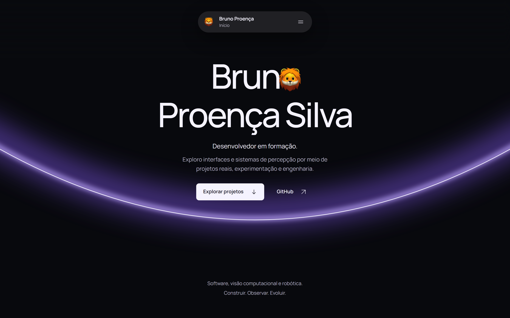

<div align="center">

# Bruno Proença Silva · Portfólio

**Software, visão computacional e robótica.**

Projetos reais, experimentação e engenharia em uma experiência web cinematográfica.

[**Explorar o portfólio ↗**](https://brunoproencasilva.vercel.app) · [GitHub](https://github.com/brunoproencadev) · [LinkedIn](https://www.linkedin.com/in/brunoproencasilva)


</div>

[](https://brunoproencasilva.vercel.app)

<p align="center"><sub>Captura real da versão publicada, com a interação do avatar no título.</sub></p>

## Sobre

Sou Bruno Proença Silva, desenvolvedor em formação. Exploro interfaces e sistemas de percepção por meio de projetos que conectam desenvolvimento web, visão computacional, robótica e ambientes virtuais.

Este repositório reúne a implementação do meu portfólio: uma apresentação com identidade própria e estudos de caso que explicam contexto, decisões técnicas, evidências e limites de cada trabalho.

## A experiência

- **Narrativa pelo scroll:** abertura com arco violeta, transições entre seções e apresentação dos projetos com GSAP e ScrollTrigger.
- **Interações com identidade:** navegação em cápsula, ferramentas dos projetos e avatar integrado ao título.
- **Conteúdo acessível:** HTML semântico, foco visível nos controles, navegação por teclado, suporte a movimento reduzido e conteúdo principal disponível sem JavaScript.
- **Layout responsivo:** composição adaptada a telas menores e imagens com tamanhos responsivos.
- **Compartilhamento e descoberta:** metadados por página, imagem Open Graph, favicon, sitemap e controle de indexação entre produção e previews.

## Projetos apresentados

| Projeto                   | Exploração                                                                                                | Estudo de caso                                                                 |
| ------------------------- | --------------------------------------------------------------------------------------------------------- | ------------------------------------------------------------------------------ |
| **RoboSense Lab**         | Percepção visual, detecção e validade de frames em experimentos de robótica.                              | [Conhecer](https://brunoproencasilva.vercel.app/projetos/robosense-lab)        |
| **Museu de Arte Moderna** | Museu virtual em Unity sobre a Semana de Arte Moderna de 1922, com créditos de participação documentados. | [Conhecer](https://brunoproencasilva.vercel.app/projetos/museu-arte-moderna)   |
| **Industry Week SENAI**   | Narrativa web interativa sobre a evolução industrial para o evento Engrenagens do Tempo.                  | [Conhecer](https://brunoproencasilva.vercel.app/projetos/industry-week-senai)  |
| **Ateliê Ingrid Xavier**  | Catálogo de peças artesanais e acesso contextual ao atendimento pelo WhatsApp.                            | [Conhecer](https://brunoproencasilva.vercel.app/projetos/atelie-ingrid-xavier) |
| **kord**                  | Brand book interativo de uma marca fictícia, desenvolvido como projeto acadêmico.                         | [Repositório](https://github.com/brunoproencadev/kordvisualidentity)           |

Cada estudo registra suas fontes, autoria e estágio de validação. A presença no portfólio não implica que todos os projetos estejam publicados ou prontos para produção.

## Tecnologias

| Camada     | Ferramentas                                            |
| ---------- | ------------------------------------------------------ |
| Aplicação  | Next.js 16 · App Router · React 19 · TypeScript strict |
| Interface  | Tailwind CSS 4 · CSS · fonte Manrope local             |
| Movimento  | GSAP · ScrollTrigger · Motion                          |
| Qualidade  | Vitest · Playwright · axe-core · ESLint · Prettier     |
| Publicação | Vercel                                                 |

As versões exatas estão em [package.json](package.json) e [package-lock.json](package-lock.json).

## Executar localmente

**Requisitos:** Node.js 24 e npm 11. Não são necessárias contas externas nem segredos para executar o site.

```sh
git clone https://github.com/brunoproencadev/portfolio.git
cd portfolio
npm ci
npm run dev
```

Abra **http://127.0.0.1:3000**. Para testar o build de produção local:

```sh
npm run build
npm run start
```

### Configuração de publicação

O arquivo [.env.example](.env.example) documenta as opções disponíveis. Para desenvolvimento, os valores padrão são suficientes; criar `.env.local` é opcional.

| Variável         | Comportamento                                                                                                                   |
| ---------------- | ------------------------------------------------------------------------------------------------------------------------------- |
| `SITE_URL`       | Origem pública HTTPS usada em canonical, compartilhamento e sitemap. Opcional localmente; obrigatória para habilitar indexação. |
| `SITE_INDEXABLE` | `false` por padrão. Usar `true` somente na publicação de produção pretendida.                                                   |

Previews da Vercel permanecem sem indexação. O deploy automático por Git está desabilitado na [configuração atual](vercel.json); o procedimento de publicação está em [LAUNCH](docs/LAUNCH.md).

## Estrutura

```text
src/
├── app/                  # Rotas, layout, metadados e estudos de caso
├── components/
│   ├── motion/           # Coreografia e ciclo de vida das animações
│   ├── navigation/       # Navegação e suas interações
│   ├── projects/         # Apresentação dos projetos
│   └── sections/         # Seções da página inicial
├── config/               # Publicação, indexação e metadados
├── data/                 # Perfil, projetos, mídias e estudos de caso
├── fonts/                # Fontes locais
└── styles/               # Tokens, layout e estilos compartilhados
public/                   # Imagens, ícones e outros arquivos estáticos
tests/                    # Testes unitários e de ponta a ponta
docs/                     # Decisões, referências e evidências de validação
```

O conteúdo fica separado da apresentação. As animações e os observadores têm limpeza de recursos e respeitam a preferência por movimento reduzido.

## Verificação

```sh
npm run format:check
npm run lint
npm run typecheck
npm test
npm run build
```

Para os testes de ponta a ponta, instale os navegadores e execute **após o build**:

```sh
npx playwright install chromium firefox webkit
npm run test:e2e -- --workers=1
```

O Playwright inicia seu próprio servidor em `127.0.0.1:3100`, que deve estar livre. A execução com um worker reduz a disputa de recursos durante uma revisão manual do site. Traces de falhas ficam em `test-results/`.

As evidências e exclusões de testes estão no [relatório de finalização](docs/FINALIZATION_REVIEW.md). **A meta de LCP segue em acompanhamento (H03)**; os resultados de laboratório não representam métricas de campo nem certificação de acessibilidade.

## Documentação

- [Produto e escopo](docs/PRD.md)
- [Direção visual e design system](docs/DESIGN_SYSTEM.md)
- [Arquitetura](docs/ARCHITECTURE.md)
- [Origem e permissões das mídias](docs/MEDIA_ASSETS.md)
- [Validação e limites conhecidos](docs/VERIFICATION.md)
- [Continuidade do projeto](docs/HANDOFF.md)

## Autoria e créditos

Portfólio de **Bruno Proença Silva**. Os projetos coletivos, as marcas, as capturas e os demais recursos têm créditos e proveniência registrados nos estudos de caso e no [inventário de mídias](docs/MEDIA_ASSETS.md). Fontes e bibliotecas mantêm suas próprias licenças.

Este repositório não declara uma licença geral de uso. Para reutilizar código ou materiais, consulte o autor e as permissões dos respectivos recursos.

**Contato:** [E-mail](mailto:brunoproencasilva@gmail.com) · [LinkedIn](https://www.linkedin.com/in/brunoproencasilva) · [GitHub](https://github.com/brunoproencadev)
