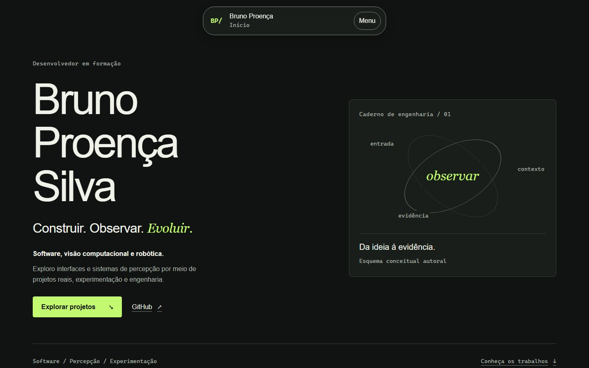
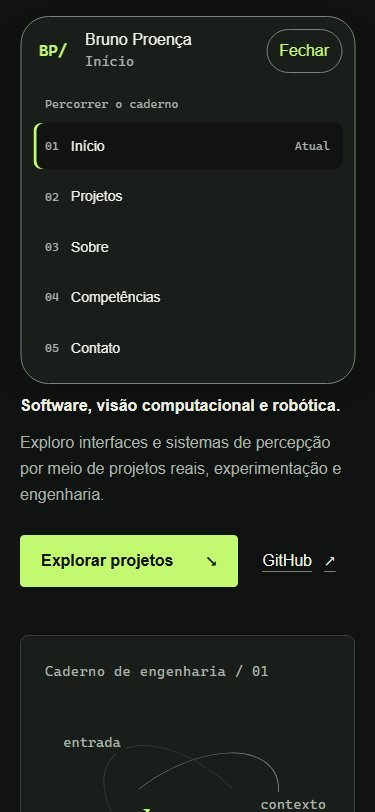

# Auditoria do redesign — Fase A

Método: duas avaliações independentes, A `/root/design_audit` (código/design e cinco screenshots), B `/root/technical_audit` (detector, navegador/testes), sintetizadas com análise direta dos vídeos pelo agente principal. Pesquisa de mídia complementar `/root/media_research`; resultados e arquivos conferidos pelo principal. Data: 2026-10-11. Modo de superfície: Experience, com leitura técnica acessível para recrutadores e colaboradores. Nenhum código visual foi modificado.

## Conclusão e causa

O projeto tem uma fundação técnica útil, mas implementa outra direção visual: um caderno de engenharia verde, com hero dividido, diagramas abstratos e reveals discretos. A principal causa está documentada: BRAND/REFERENCES recusaram o arco roxo; DESIGN_SYSTEM excluiu animação de altura/saída da cápsula e scrub/pin/parallax. O código seguiu esse escopo. Não se trata de ausência de bibliotecas: GSAP já existe e Motion está instalado, sem import na aplicação.

O redesign precisa substituir esses contratos e reconstruir composição/coreografia, preservando dados, rotas, SEO, semântica e fallbacks. O brief atual resolve a divergência de direção; a escolha visual final será apresentada na Fase B.

## Repositório e arquitetura inspecionados

- Raiz confirmada `D:\projects\portifolio`, sem aplicação aninhada; branch existente `redesign/cinematic-portfolio` preservada.
- Baseline `aa70f4c73008f85731e4f45e528ac2c7f8737d0f`; status inicial limpo. Não havia mudanças do usuário a guardar/commitar. O histórico existente já oferece ponto de recuperação; não foi criado reset/stash ou reescrito commit.
- Origin fetch/push `https://github.com/brunoproencadev/myportifolio.git`, sem alteração. Histórico recente: aa70f4c documentação do lançamento; 0272dea preparação/gate; 8f8904b SEO; f4004af ícones; db00672 QA. Não houve fetch/push/deploy nesta auditoria; estado remoto do lançamento é histórico documentado, não novo push confirmado.
- npm com `package-lock.json`, Node 24.15.0. Next 16.4.0, React 19.3.0, TypeScript strict, Tailwind 4, GSAP 3.15.0, Motion 14.1.0, Vitest/Playwright/axe/Lighthouse disponíveis. Nenhuma dependência alterada/instalada.
- Home/layout/cases renderizados no servidor; conteúdo em `src/data`; ilhas client `SiteNavigation` e `HomeMotion`; erro client separado. CSS global é dono dos tokens. Não há necessidade de trocar framework, roteamento ou estratégia de dados.
- Inspeção documental: AGENTS/CODEX/README, PRD, ARCHITECTURE, BRAND, DESIGN_SYSTEM, CONTENT, PROFILE_RESEARCH, REFERENCES e capturas, ASSETS, AUDIT, IMPLEMENTATION_PLAN, TASKS, HANDOFF, VERIFICATION, QA_PHASE7 e LAUNCH. Registros antigos misturam gates superados com status corrente; novos cabeçalhos de continuidade apontam ao redesign sem apagar histórico.

## Componentes: conservar, melhorar ou reconstruir

| Elemento / arquivos                              | Classe                        | Justificativa e alcance futuro                                                                                                                                                                |
| ------------------------------------------------ | ----------------------------- | --------------------------------------------------------------------------------------------------------------------------------------------------------------------------------------------- |
| App Router, strict, configs e lock               | KEEP                          | Base proporcional e verificável. Não recomeçar projeto ou instalar dependências especulativas.                                                                                                |
| `src/data/portfolio.ts`, `case-studies.ts`       | KEEP / IMPROVE                | Preservar fatos/fontes/slugs; adicionar proveniência de mídia e novas informações somente verificadas. Dados continuam separados.                                                             |
| `src/config/site.ts`, layout, robots/sitemap/OG  | KEEP                          | Gates de indexação e metadados existentes; estética de OG poderá alinhar à marca depois. Não tocar publicação em A.                                                                           |
| Controle de `site-navigation.tsx`                | KEEP                          | Disclosure, foco, Escape, destinos, aria-current, no-JS e limpeza já têm provas.                                                                                                              |
| Apresentação da ilha + CSS `.capsule`            | REBUILD                       | `hidden` troca painel imediatamente; só filhos entram por 8px/280ms. Largura invariável não reproduz R1; reconstruir superfície/transição sem substituir navegação por dropdown convencional. |
| Hero em `page.tsx`, CSS `.hero`/`.hero-notebook` | REBUILD                       | Título e caixa orbital são dois blocos, sem arco/cena violeta; referências pedem composição dominante unificada. Preservar nome/posicionamento/CTA.                                           |
| `home-motion.tsx`                                | KEEP / IMPROVE                | Bom dono de imports/cancelamentos/watchdog; ampliar coordenação com intro/hero sem desmontar garantias.                                                                                       |
| `home-sequence.ts`                               | REBUILD                       | Deslocamentos 16px não reproduzem desenho manuscrito nem máscara de entrada; mudar coreografia em E/D, não controlar conteúdo SSR.                                                            |
| `home-reveals.ts`                                | REBUILD                       | y24px/700ms, `once:true`, `top 90%` é reveal pontual; faltam continuidade/progresso/reversão observados.                                                                                      |
| `projects.map` e `.project-grid`                 | REBUILD                       | Três cartões repetem proporção/ordem/forma; cenas com mídia real precisam de composição própria. Preservar links e dados.                                                                     |
| `ProjectIllustration`                            | IMPROVE / REMOVE seletivo     | Diagramas autorais honestamente rotulados são úteis em arquitetura; deixar de ser única evidência visual/promocional. Não apagar diagramas úteis sem consumidor substituto.                   |
| Sobre/competências/contato/footer                | IMPROVE                       | Hierarquia e ritmo, fotos se confirmadas, competências por evidência. Links simples bastam; sem formulário/CMS. Ano depende do build e permanece no checklist anual.                          |
| `/projetos/[slug]`, erro e 404                   | KEEP / IMPROVE                | Rotas/dados/recuperação prontos; renovar apresentação e mídia posteriormente sem quebrar URLs.                                                                                                |
| `icon.svg`, `apple-icon.tsx`                     | REBUILD na fase alocada       | BP/ não satisfaz avatar exato do GitHub. Avatar atual confirmado; integração somente G, verificação I.                                                                                        |
| Tokens, fontes, grid em `globals.css`            | IMPROVE                       | Preservar centralização; B revisará valores e licenças/contraste. Não manter verde/Arial por inércia.                                                                                         |
| Proibições antigas de arco/layout motion/scroll  | REMOVE como restrição vigente | Preservar registro histórico, explicitar precedência do master prompt. Não remover restrições de segurança/acessibilidade junto.                                                              |

Não há remoção de código autorizada nesta fase; REMOVE descreve decisão de escopo futuro, não alteração executada.

## Comparação renderizada e prioridades

1. **P1 — Hero de direção divergente.** Nome grande à esquerda, caixa orbital à direita, superfície verde uniforme; R2 tem eixo central, arco em escala de viewport e troca de planos. Resolver composição, não apenas aplicar outra cor de glow.
2. **P1 — Ilha sem transformação contínua.** Medição Chromium local: desktop 448×70→448×383,97, mobile 335×70→335×367,95; largura invariável. Vídeo R1: ≈322×54→404×368. Código explica troca instantânea de geometria; não é falha dos handlers.
3. **P1 — Coreografia não cria narrativa.** Intro integrada ao diagrama e reveals isolados; nenhuma escrita, máscara de saída ou showcase por scroll. Reusar cancelamentos; trocar timelines no dono correto.
4. **P1 — Trabalho real invisível na apresentação principal.** Três diagramas conceituais honestos, mas nenhuma aplicação/foto real. Capturas autênticas já foram localizadas; ver MEDIA_ASSETS.
5. **P2 — Ritmo e identidade pouco específicos.** Sequência de cartões, linhas e textos mantém o mesmo registro até o contato. Avatar/experiências reais e escalas de mídia podem diferenciar Bruno sem estatísticas fictícias.

Forças: posicionamento em formação claro, integridade factual, textos/CTAs legíveis, menu compreensível no mobile e isolamento técnico de movimento. Recrutador precisa ver artefatos mais cedo; colaborador técnico precisa conservar acesso a fontes/limites; teclado/reduced motion não podem perder capacidades ao introduzir efeitos.

Avaliação heurística A: 20/28 pontos aplicáveis, julgamento de revisão e não benchmark. Estado, linguagem, controle, consistência, prevenção e reconhecimento receberam 3/4 cada; estética/minimalismo 2/4 por divergência do objetivo. Flexibilidade operacional e ajuda não se aplicam a esta superfície; recuperação de erro não foi pontuada porque não apareceu nas cinco capturas. O resultado não mede fidelidade cinematográfica nem certifica acessibilidade. A captura full-page pode reposicionar elementos fixos/focados; não foi usada isoladamente para afirmar bug de posição.

## Provas atuais e limites

| Checagem                                     | Resultado desta fase                                                                                                                                |
| -------------------------------------------- | --------------------------------------------------------------------------------------------------------------------------------------------------- |
| Impeccable detector `src/app src/components` | `[]`, exit 0, executado uma vez; zero achados. Não cobre todos os estilos nem julga fidelidade.                                                     |
| Unitários completos                          | 6 passaram, tooling excedeu timeout de 60s (71,9s observado; rodada 82,65s).                                                                        |
| Tooling isolado, mesmo timeout               | Passou em 3,95s, lint interno 3,26s. Não transforma retrospectivamente a rodada completa em verde.                                                  |
| E2E navegação + motion                       | 18/18 Chromium, dois workers, 33,3s; fallback no-JS, teclado, cancelamentos/falhas preservados.                                                     |
| Captura adicional 1440×900 e 375×812         | Zero pageerrors e violações axe no menu aberto; Escape/foco, Projetos/hash/contexto e reduced sem intro confirmados. Sem overflow nas verificações. |
| Vídeos locais                                | Três decodificados integralmente; metadados/frames/hashes e sequências revisados.                                                                   |
| Integridade de implementação                 | Nenhuma alteração em src/tests/configs/lock; alteração restrita a documentação/evidência.                                                           |

Navegador: Chromium 156.0.8078.4, Playwright instalado. CUA não tinha browsers disponíveis; Playwright foi alternativa. UI/E2E usaram build local existente de 2026-10-11, não build novo atribuível a um hash por manifesto. O código de origem permanece igual ao baseline, mas essa captura não certifica reprodutibilidade de rebuild. Detector não teve overlay injetado; inspeção por screenshots/DOM/testes. Nenhum live-server do Impeccable foi iniciado. Servidor Next temporário PID 36552 e servidor E2E encerrados; browsers fechados. Arquivos de prova temporária foram mantidos em `.audit/phase-a`, ignorados, para revisão; nenhuma exclusão de evidência do usuário.

Não foram repetidos Lighthouse, audit de dependências, suite completa multibrowser, novo build/typecheck/lint completo, leitor de tela ou dispositivos físicos; A é documental e o código não mudou. Métricas 99–100 do QA anterior permanecem históricas, não evidência da futura UI. Risco conhecido de suporte ESLint/braces está em AUDIT/QA_PHASE7, sem alegar atualização da consulta. Timeout frio de tooling permanece como instabilidade observada, sem correção especulativa fora de escopo.

## Próxima decisão

Aprovar a Fase B permite transformar estes comportamentos em direção de arte/tokens/composições e protótipos revisáveis. Não autoriza implementar C, alterar produção, integrar favicon agora ou fazer push. Critérios e comparação contínua em VISUAL_ACCEPTANCE_CRITERIA; gates em VISUAL_REDESIGN_PLAN.
