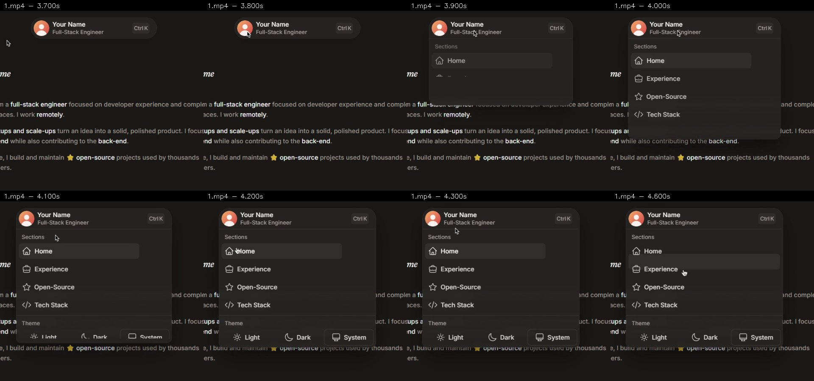
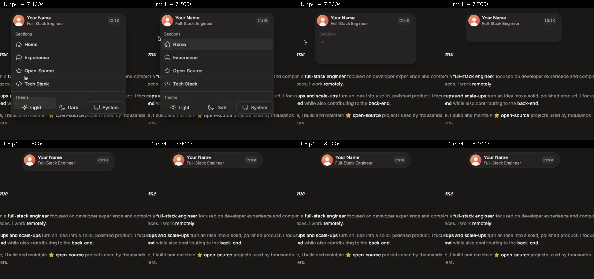
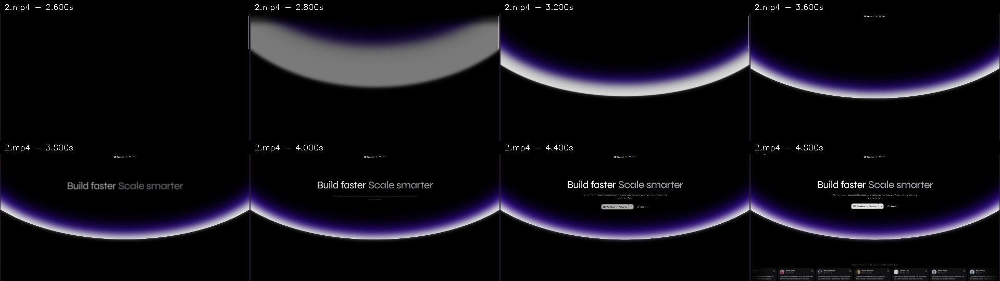
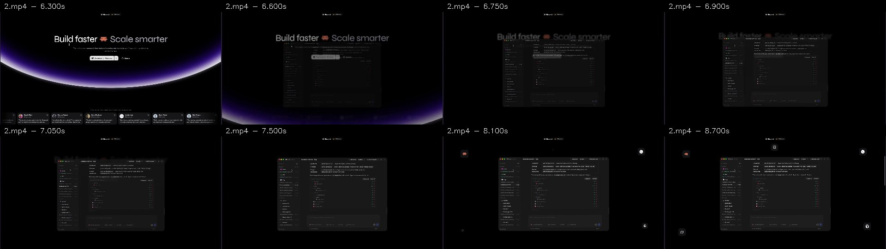
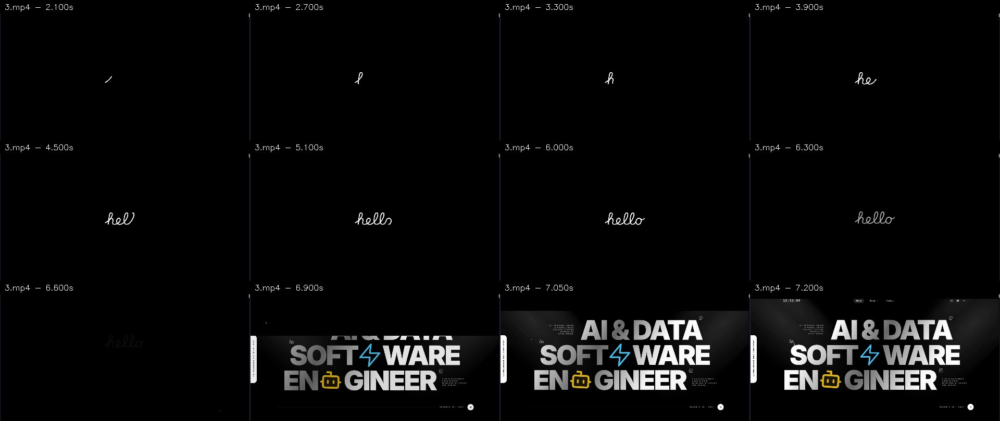
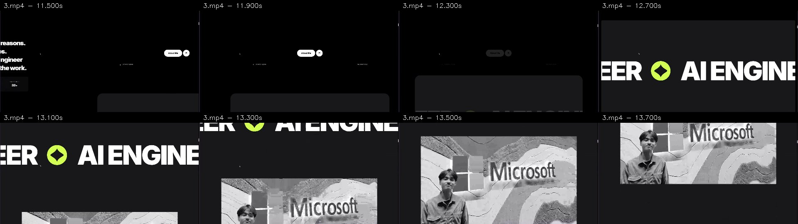
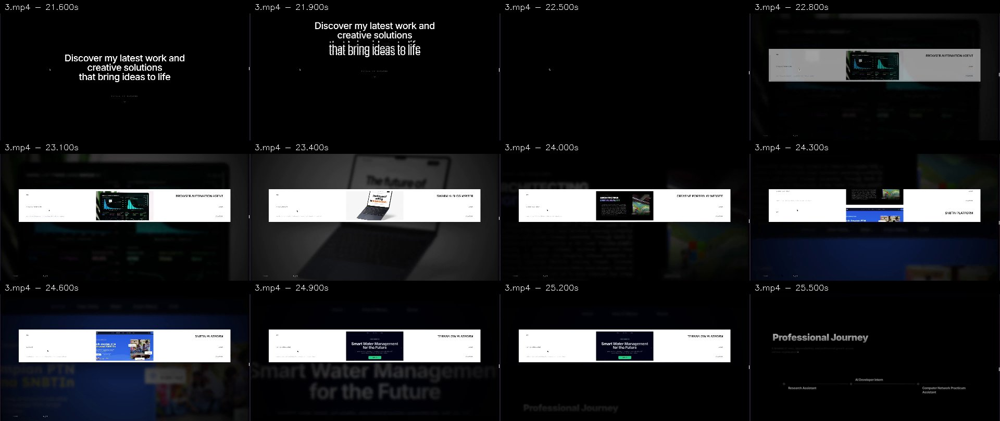
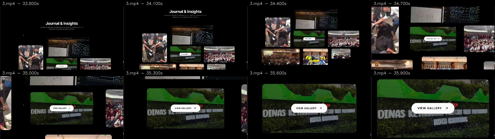

# Análise dos vídeos locais — Fase A

Data: 2026-10-11. Fonte prioritária: `D:\aNova pasta\Desktop\coisas after\references`, somente leitura. Esta análise substitui as decisões de simplificação de [REFERENCES](REFERENCES.md), preservado como histórico. Não é aprovação de implementação nem direção de arte final da Fase B.

## Método e integridade

Mapeamento confirmado pelos pixels e conteúdo das páginas, não pelos nomes. Todos são gravações desktop 1920×1080, H.264 High/yuv420p BT.709, 60 fps; áudio AAC 48 kHz estéreo. FFmpeg 7.1 disponível no ambiente existente do RoboSense foi usado somente como ferramenta de leitura, sem modificar aquele projeto. Decodificação completa dos três vídeos terminou com exit 0. OpenCV 4.14.0 extraiu metadados, 16 amostras por vídeo e sequências de 100–300ms em oito transições; a abertura da navegação recebeu também medição em 40 frames consecutivos a 60 fps.

FFprobe não está no PATH nem no pacote FFmpeg local encontrado; metadados foram cruzados entre FFmpeg e OpenCV, sem instalar dependências. O FFmpeg mínimo do Playwright não leu MP4 e retornou `Invalid data found`; o FFmpeg completo leu os mesmos arquivos. Isso não indicava corrupção dos vídeos. A chamada inicial apenas com `-i` terminou em 1 por não especificar saída; a validação posterior usou `-map 0:v:0 -f null -` e passou.

| Arquivo | Referência confirmada                      | Duração / frames | Bytes      |
| ------- | ------------------------------------------ | ---------------- | ---------- |
| 1.mp4   | R1 — Dynamic Island / personal-site-kit-v2 | 28,233s / 1694   | 8.848.026  |
| 2.mp4   | R2 — T3 Code / arco violeta                | 18,133s / 1088   | 5.671.661  |
| 3.mp4   | R3 — Syahril / hello, editorial e scroll   | 41,117s / 2467   | 12.898.649 |

SHA-256 dos originais, conferidos novamente após extração:

```text
1.mp4 6f4cb6361880ce525033acbb2b4f8dae3b922b5f18cd15732070721662f0dbbe
2.mp4 b48144ca3ce0f4186e0f0091e5d4ca85de34159b0135a2290ad5ed61479feb77
3.mp4 70c73a02bf6f0379c2e6bbb3a86fcc4b12fabd9fbd308a4cee8dd1c6917058bc
```

[Manifesto de evidências](reference-video-audit/manifest.json) registra fontes, tempos e retângulos de recorte. Pranchas selecionadas têm redimensionamento e timestamp, sem redesenhar os pixels. Barra do navegador e telas do OBS foram excluídas das imagens versionadas; originais, panoramas brutos, medições experimentais e scripts ficam fora do Git em `.audit/phase-a`. Capturas das referências são documentação, nunca assets/trabalho de Bruno. Os vídeos incluem troca de aplicativo no início/fim; esses trechos não são animação do site.

Tempos abaixo são posições na gravação, não tempos desde navegação nem medidas de carregamento. Dimensões são pixels capturados, sem confirmação do DPR/zoom do navegador de origem. Easing é estimativa perceptual; código, biblioteca, eventos de clique e distância de scroll não são recuperáveis com certeza pelos pixels.

## R1 — cápsula que se transforma

Fonte: <https://personal-site-kit-v2.21st.app/>. Trecho útil aproximadamente 0,6–8,5s; restante mostra o gravador/configurações.





| Instante   | Observação direta                                                                                           |
| ---------- | ----------------------------------------------------------------------------------------------------------- |
| 3,70–3,80s | Cápsula compacta central; avatar circular à esquerda, identidade em duas linhas, Ctrl K à direita.          |
| 3,90s      | Superfície já mais larga/alta; primeiras opções aparecem recortadas durante a expansão.                     |
| 4,00–4,20s | Opções e grupo inferior surgem em sequência; a superfície e a identidade permanecem contínuas.              |
| 4,30s      | Painel estabilizado; quatro seções com ícones de traço e bloco de tema separado por linha.                  |
| 4,40–7,50s | Destaque retangular acompanha passagem do ponteiro entre opções; não prova troca da seção ativa por scroll. |
| 7,60–7,80s | Conteúdo desaparece/é recortado enquanto largura e altura encolhem; identidade permanece.                   |
| 7,90–8,10s | Cápsula compacta novamente, sem deixar painel destacado abaixo.                                             |

Geometria aproximada: fechada `(x799,y127,w322,h54)`; aberta `(x758,y127,w404,h368)`. Centro x≈960 e topo≈127 preservados; largura cresce ≈25%, altura ≈6,8 vezes. Topo da página capturada começa em y≈80: afastamento visual≈47px. Raio fechado≈27px; aberto≈24–28px. Avatar≈40px. Corpo cinza quente quase preto, borda discreta e sombra sob o painel; texto claro e secundário cinza. A identidade não é substituída por outro cabeçalho. Medidas por segmentação de luminância foram conferidas visualmente; tolerância de borda/antialias de poucos pixels, não CSS exato.

Abertura observada em aproximadamente 3,8–4,3s; fechamento 7,5–7,9s. Movimento desacelera ao acomodar; não há evidência suficiente para identificar parâmetros de spring nem overshoot exato. O ponteiro se aproxima da identidade antes da abertura e sai antes da contração: hover é hipótese plausível, clique não é comprovado pela gravação. Produto futuro usará ativação explícita por botão/toque/teclado e fechamento acessível; hover não será requisito.

Estratégia proposta para C: preservar o disclosure existente, trocar a camada de apresentação por um único invólucro animado com Motion já instalado, dimensões de conteúdo medidas e clipping local. Coordenar filhos sem deformar texto/avatar. Ctrl K, temas e destinos fictícios do template não são requisitos do portfólio. A identidade real pode exigir largura distinta, especialmente no mobile.

## R2 — composição luminosa e troca de cena

Fonte: <https://t3code-cinematic-dark-saas-landing-page-template-v2.21st.app/>.





| Instante     | Observação direta                                                                                                                         |
| ------------ | ----------------------------------------------------------------------------------------------------------------------------------------- |
| 0,60–2,40s   | Hero já visível; não inferir entrada original desse trecho. Título central em dois tons, símbolo intercambiável, descrição e CTAs abaixo. |
| 2,60–3,60s   | Composição reinicia: tela preta, arco muito difuso, depois contorno luminoso mais definido. Causa do reinício não confirmada.             |
| 3,80–4,80s   | Título/apoios retornam em etapas sobre o arco estabilizado.                                                                               |
| 6,30–7,05s   | Arco desce/sai; texto perde definição; screenshot escuro do produto entra sobre a região central e aumenta.                               |
| 7,20–8,70s   | Screenshot permanece como foco e surgem pequenos ícones ao redor.                                                                         |
| 9,60–12,10s  | Conteúdo inferior, composição de integrações e CTA final.                                                                                 |
| 13,20–16,80s | Percurso reverso: screenshot/hero reaparecem. A cena não é apenas reveal executado uma vez.                                               |

O arco atravessa toda a largura, com borda quase branca na base e halo violeta dirigido para dentro; sua curvatura cria uma grande superfície negra acima. Não é uma mancha radial atrás do título. No quadro 4,8s, vértice inferior está por volta de 68% da altura útil, e as extremidades sobem para aproximadamente 43%; usar essas relações como guia, não pixels CSS. Título e CTA ocupam o eixo central; a faixa inferior de cartões dá escala e separação vertical. A linha tipográfica principal está perto do terço superior. Preto domina, luz ocupa uma faixa controlada. Fonte exata não é identificável pelo vídeo; a pesquisa web anterior registrou Syne, informação complementar em REFERENCES.

O screenshot muda escala/posição e há desfoque transitório; pin/scrub/GSAP ou técnica equivalente são estratégias possíveis, não bibliotecas comprovadas. Duração 6,3–7,1s depende do gesto gravado, não deve virar duration fixa. Planejar keyframes por progresso de scroll, validar reversão e rolagem rápida.

Estratégia para D/F: SVG/CSS para arco elíptico com camadas de brilho contidas, GSAP para cena hero→trabalho real. Não requer WebGL para reproduzir o que foi observado. Testar custo de blur/paint antes de adotar efeito animado extenso. Depoimentos, marcas e conteúdo SaaS não pertencem à história de Bruno; faixa inferior deve usar informação/projetos confirmados.

## R3 — intro e narrativa contínua

Fonte: <https://www.syahrilarfianalmazril.my.id/>.









| Intervalo  | Observação direta                                                                                                                                                        | Limite / implicação                                                                              |
| ---------- | ------------------------------------------------------------------------------------------------------------------------------------------------------------------------ | ------------------------------------------------------------------------------------------------ |
| 1,8–5,1s   | Traço branco cursivo escreve hello no centro de fundo preto: início de h, he, hel, hell, hello.                                                                          | Desenho progressivo, não troca de opacidade da palavra inteira. Sem indicador percentual.        |
| 5,1–6,3s   | Palavra concluída permanece; depois perde intensidade.                                                                                                                   | Pausa narrativa; não prova espera de rede.                                                       |
| 6,6–7,2s   | Tela preta retrai para cima, expondo a página a partir de baixo; título editorial enorme já compõe a cena.                                                               | Aproximadamente 0,6s neste registro; técnica de máscara/transform é hipótese.                    |
| 7,2–10,9s  | Hero oversized e frase editorial em estilos contrastantes; scroll leva a apresentação/indicadores.                                                                       | Não transferir senioridade, números ou credenciais do autor da referência.                       |
| 11,5–13,7s | Conteúdo sai lateralmente; painel arredondado entra e cresce, faixa tipográfica atravessa a cena, fotografia real aparece em grande escala.                              | Sequência combina tradução e escala; vídeo não expõe distância de scroll nem pin técnico.        |
| 15,3–20,5s | Objeto cúbico colorido muda orientação/posição entre composições de competências alternadas.                                                                             | Aparência 3D observada; Three.js não comprovado nem necessário no portfólio.                     |
| 21,6–22,8s | Frase de abertura muda estilo/escala e cede lugar ao showcase.                                                                                                           | Não substituir por fade idêntico em todos os elementos.                                          |
| 22,8–25,2s | Faixa clara horizontal estável, screenshot nítido central e título lateral; projetos trocam verticalmente dentro da faixa. Fundo ampliado/desfocado acompanha o projeto. | Continuidade de uma cena, não grid de cartões nem prova de carousel por clique.                  |
| 25,5–28,5s | Linha temporal horizontal e cartões de experiência aparecem.                                                                                                             | Conteúdo factual de Bruno insuficiente para reproduzir cargos/datas.                             |
| 29–33s     | Painéis de atividade e composição com caixa; tipografia alterna peso/serif.                                                                                              | Não copiar métricas nem criar widget sem dados.                                                  |
| 33,8–35,9s | Mosaico de fotos cresce; foto central com CTA ganha quase toda a tela, periféricas saem pelos limites.                                                                   | Boa referência para galeria somente se houver fotos suficientes, autorizadas e contextualizadas. |
| 37–39s     | Faixas tipográficas diagonais antecedem contato/rodapé.                                                                                                                  | Ritmo de encerramento observável; não exige duplicar todo efeito.                                |

Estratégia para E: palavra manuscrita original e máscara de saída controlada, preservando skip/timeout/falhas do controlador atual. A espera de cerca de 5s do vídeo não será copiada automaticamente; propor duração curta na especificação, sem progresso fictício. Para F: cena com keyframes e screenshots autênticos; leitura normal no mobile/reduced motion, âncoras/foco livres. A galeria pessoal depende de originais: não usar as fotografias desta referência como se fossem de Bruno.

## O que os vídeos não demonstram

Não há demonstração mobile, leitor de tela, teclado, sem JavaScript, reduced motion, FPS real de renderização, DPR/zoom, INP, LCP ou implementação interna. 60 fps é taxa do arquivo, não benchmark da página. Easing exato, distância de scroll e causa de reloads não foram confirmados. Usar protótipos futuros para validar essas decisões; não chamar estas aproximações de pixel-perfect.

Comparação com o produto atual e classificação de componentes: [REDESIGN_AUDIT](REDESIGN_AUDIT.md). Contratos propostos: [MOTION_SPEC](MOTION_SPEC.md). Critérios verificáveis: [VISUAL_ACCEPTANCE_CRITERIA](VISUAL_ACCEPTANCE_CRITERIA.md).
